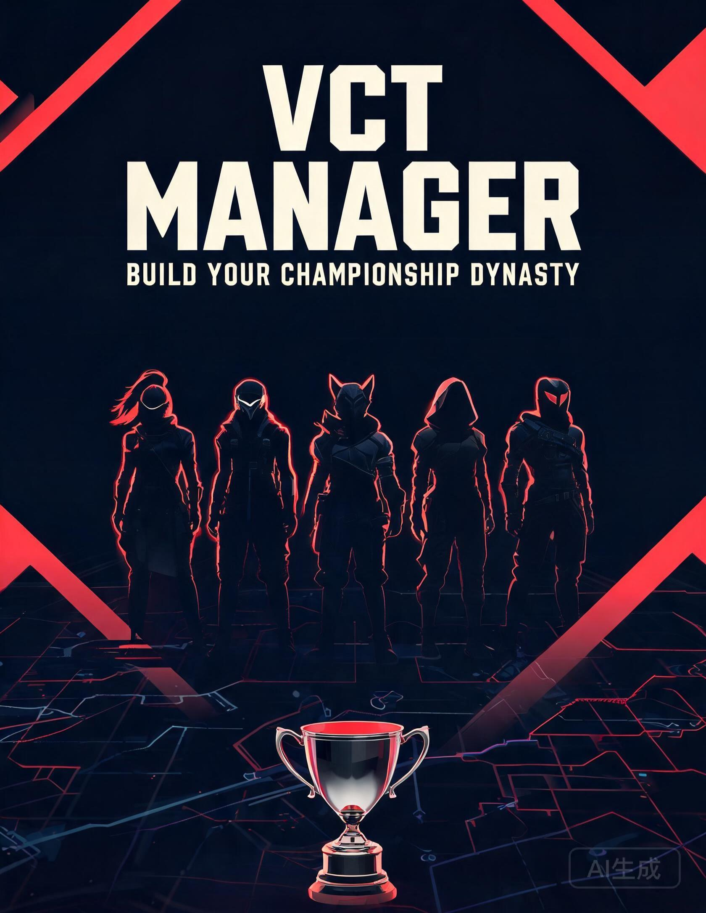

# VCT 战队经理 · Valorant Manager

一款纯前端的《无畏契约》战队经营模拟游戏。包含 53 支 VCT 战队、170 名职业选手、
完整联赛金字塔（顶级联赛 / Challengers 次级联赛 / Masters / Champions）、24 周赛季、
比赛 MVP 与选手数据统计，并支持基于 GitHub 仓库的云存档、全球排行榜、创意工坊、
站内邮箱、玩家对战（阵容码友谊赛 / 同屏双人）与战绩分享。

- 版本：**v1.2.0**
- 技术栈：HTML + CSS + 原生 JavaScript（零依赖、零构建）
- 后端：GitHub 仓库（GitHub Pages 托管 + GitHub Contents API 存储）

[](promo/vct-manager-poster.jpg)

---

## 快速开始

### 本地游玩

任选一种：

```bash
# Python
python -m http.server 8080

# Node
npx serve .
```

浏览器打开 `http://localhost:8080`。

> 直接双击 `index.html` 也能玩，但本地文件协议下云端功能可能受浏览器安全策略限制，建议用本地服务器。

### 部署到 GitHub Pages

1. 在 GitHub 新建仓库（建议 **Public**，私有仓库的 Pages 需要付费账户）。
2. 把本目录全部文件推送到 `main` 分支：

```bash
git init
git add .
git commit -m "feat: VCT Manager v1.0.0"
git branch -M main
git remote add origin https://github.com/<你的用户名>/<仓库名>.git
git push -u origin main
```

3. 仓库 **Settings → Pages → Build and deployment**，把 Source 选为 **GitHub Actions**。
4. 推送后 `.github/workflows/deploy.yml` 会自动部署，地址：
   `https://<用户名>.github.io/<仓库名>/`

---

## 云端功能配置

游戏本身完全可以在离线状态下运行（使用 localStorage 存档）。云端为可选能力。

进入游戏后点击顶栏 **☁** 图标，或开始界面「云端设置」：

| 字段 | 填写内容 |
| --- | --- |
| 仓库所有者 | 你的 GitHub 用户名或组织名 |
| 仓库名 | 存放游戏的仓库 |
| 分支 | 通常为 `main` |
| 访问令牌 | Fine-grained PAT |

### 创建访问令牌

1. GitHub → **Settings → Developer settings → Personal access tokens → Fine-grained tokens**
2. **Repository access** 选择 *Only select repositories*，勾选你的游戏仓库
3. **Permissions → Repository permissions → Contents** 设为 **Read and write**
4. 生成后复制令牌，粘贴到游戏内并点击「测试连接」

令牌只保存在你本机浏览器的 localStorage，不会上传到任何地方。

---

## 云端数据结构

所有数据都写在仓库的 `data/` 目录，用提交记录天然形成版本历史：

```
data/
├── leaderboard.json            全球排行榜（单文件，写入时合并去重）
├── saves/
│   └── <playerId>.json         每位玩家的云存档
└── workshop/
    ├── index.json              创意工坊索引（名称、作者、战力等摘要）
    └── items/
        └── <id>.json           作品详情（完整阵容）
```

- 云存档按本机生成的 `playerId` 命名，互不覆盖。
- 排行榜与工坊索引采用「读取 → 合并 → 写回 + 冲突重试」策略处理并发。
- 每次比赛结束会自动上传云存档；赛季结束时额外提交一次排行榜战绩。

---

## 安全与隐私

这套方案没有服务器，因此必须了解以下边界：

1. **令牌即写入权限。** 令牌泄露等同于该仓库 `Contents` 写权限泄露。不要把令牌写进源码、截图或公开聊天。
2. **公开仓库 = 公开数据。** 若仓库为 Public，`data/saves/` 与 `data/workshop/` 中的内容任何人都能读取。
   只想自己用时，请把仓库设为 Private（私有仓库 Pages 需 GitHub Pro），或不要上传云存档。
3. **无法防作弊。** 排行榜由客户端提交，任何人都能伪造战绩。它适合朋友间的小圈子，不适合当作严肃竞技榜单。
4. **GitHub API 限流。** 认证请求 5000 次/小时，未认证 60 次/小时。游戏已对读取做 30 秒缓存。

---

## 游戏内容

| 模块 | 说明 |
| --- | --- |
| 我的战队 | 阵容、选手属性、续约/释放/直接移除、战力总评 |
| 转会市场 | 27 名特工 + 170 名真实风格职业选手（每期 8 名职业选手） |
| 赛程 | 24 周赛季：常规赛两阶段 + Masters 八强/半决赛/决赛 + Champions 八强/半决赛/决赛 |
| 积分榜 | 顶级联赛 / Challengers 次级联赛双榜，升降级区标记 + 选手排行榜 |
| VCT 战队 | 全部 53 支战队背景故事与完整阵容（按联赛分组） |
| 商城 | 22 件外观/便利道具，七大分类，不影响任何比赛数值 |
| 全球榜 | 云端玩家战绩排名 |
| 创意工坊 | 发布/载入玩家自创战队 |
| 分享 | 一键复制战绩文案、系统分享、导出 PNG 分享卡片 |
| 管理员控制台 | `Ctrl + Shift + A` 打开（金币、时间、属性、存档、调试） |

---

## 目录结构

```
.
├── index.html              页面结构
├── style.css               全部样式
├── game.js                 游戏逻辑与云端接入
├── github-backend.js       GitHub Contents API 封装（云存档/排行榜/工坊）
├── promo/                  宣传海报
├── .github/workflows/      Pages 自动部署
├── .nojekyll               关闭 Jekyll 处理
└── data/                   云端数据（首次写入时自动创建）
```

---

## 赛事体系（参考现实 VCT）

```
                 ┌─────────────┐
                 │  Champions  │  赛季末 · 常规赛前 8 名
                 └──────┬──────┘
                        │
   ┌────────────────────┴────────────────────┐
   │          VCT 顶级联赛（Tier 1）          │
   │  常规赛第一阶段 → Masters → 第二阶段      │
   └────────────────────┬────────────────────┘
                        │ 升降级（末 2 名 ↓ / 前 2 名 ↑）
   ┌────────────────────┴────────────────────┐
   │      Challengers 次级联赛（Tier 2）      │
   └─────────────────────────────────────────┘
```

| 周次 | 阶段 | 说明 |
| --- | --- | --- |
| 1–9 | 常规赛第一阶段 | 每队每周 1 场；AI 战队同周进行模拟比赛 |
| 10–12 | Masters | 联赛前 8 名单败淘汰（八强 / 半决赛 / 总决赛） |
| 13–21 | 常规赛第二阶段 | 继续积分，决定 Champions 名额 |
| 22–24 | Champions | 联赛前 8 名单败淘汰（八强 / 半决赛 / 总决赛） |
| 赛季末 | 结算 | 升降级、奖金发放、进入下赛季 |

- **升级**：Challengers 前 2 名下赛季升入顶级联赛。
- **降级**：顶级联赛末 2 名下赛季降入 Challengers。
- **自创战队**将从 Challengers 起步，带队冲上顶级联赛。
- 杯赛不影响联赛积分，但冠军会获得额外奖金与联盟邮件。

---

## 版本记录

### v1.2.0
- 新增完整联赛金字塔：VCT 顶级联赛 + Challengers 次级联赛，独立积分榜与升降级
- 新增季中 Masters 与季末 Champions 八强单败淘汰赛，参照现实 VCT 赛制
- AI 战队每周自动模拟比赛，积分榜动态变化；赛季末自动结算并进入下赛季
- 「我的战队」新增「移除」：直接移除特工、腾出阵容位，不返还资金，需二次确认
- 新增 13 支战队（Heretics、FUT、Eternal Fire、Leviatán、MIBR、TALON 等）与 60 名选手
- 商城扩充至 22 件道具，按队徽 / 主题 / 称号 / 对局外观 / 横幅 / 收藏 / 便利分类
- 新增游戏公告（开始界面 + 控制台 + 邮箱推送）与战绩分享文案 / PNG 分享卡片

### v1.1.0
- 自创战队进入时弹窗提醒起名，控制台保留未命名提示条
- 新增站内邮箱：欢迎信、赛季奖金、购买凭证、工坊回执，支持未读角标与奖励领取
- 新增战队商城：队徽、主题、称号、改名卡、自动存档卡，全部为外观/便利道具，不修改比赛数值
- 新增玩家对战：阵容码异步友谊赛、创意工坊战队挑战、同屏双人战术卡对战
- 可视化对局：战术板、回合进度条、回合战报、MVP 结算卡片，支持暂停 / 1× / 2× / 跳过

### v1.0.0
- 正式版发布：40 支战队、110 名职业选手、27 名特工、24 周赛季
- 新增 GitHub 云存档、全球排行榜、创意工坊
- 新增管理员控制台
- 移动端适配（导航双行铺开、积分榜内部横向滚动、窄屏字号与间距调整）与错误提示优化

---

## 许可

MIT License，详见 [LICENSE](LICENSE)。

本项目为粉丝向作品，与 Riot Games 无隶属关系。VALORANT、VCT 及相关名称与标识归 Riot Games 所有。
